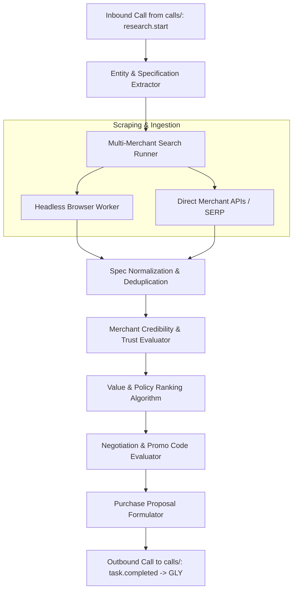

# ARB Technical Context & Operating Architecture

> **Module:** ARB (ArbitrationPal)  
> **Lifecycle Phase:** Phase 0 (Specification Baseline)  
> **Target Audience:** AI Coding Agents assigned to ARB

---

## 1. Internal Architecture

ARB consists of five modular pipelines executing as asynchronous task consumers:

---

## 2. Research & Comparison Engine Workflow

1. **Extraction of Invariants:**
   - ARB extracts hard requirements (e.g., `RAM >= 16GB`, `Price <= 75000 INR`, `GPU = RTX 4060`) versus soft preferences (`Color = Space Gray`).
2. **Search Execution:**
   - Dispatches parallel scraping jobs across whitelisted merchant domains (e.g., Amazon, Flipkart, official brand stores).
3. **Specification Normalization:**
   - Maps divergent merchant listings (e.g., "16 GB Unified Memory" vs "16GB LPDDR5") into a standardized schema for apples-to-apples comparison.
4. **True Landed Cost Calculation:**
   - Item price alone is insufficient. ARB extracts postal delivery fees, estimated customs/taxes, and packaging surcharges to output the actual payable amount.

---

## 3. Merchant Credibility & Trust Scoring Model

ARB evaluates sellers on a 0–100 Trust Index based on verifiable signals:
- **Domain Verification:** Domain age, SSL certificate chain, whois transparency.
- **Review Sentiment & Distribution:** Detection of bot-farmed 5-star reviews and cluster analysis of 1-star complaints.
- **Return & Refund Policy Clarity:** Verifies whether the merchant offers a minimum 7-day return/replacement window.
- **Payment Safety:** Confirms whether the merchant supports secure payment methods (such as PayPal) rather than unverified direct wire transfers.

*Invariant:* ARB will never recommend an unknown seller merely because their sticker price is lower if their Trust Score falls below the user's defined trust threshold (default: 80/100).

---

## 4. Deal Arbitration & Negotiation Rules

- **API-Based Negotiation:** Where merchant platforms provide dynamic quote APIs or volume discount inquiries, ARB presents the user's target price and parameters.
- **Promotional Arbitration:** ARB systematically tests verified merchant promotional codes and payment-method discounts.
- **Transparency Mandate:**
  - If a price reduction was achieved via a publicly available coupon code, ARB must state: *"Applied promotional voucher SAVE10"*.
  - ARB must NEVER state: *"I negotiated a custom discount with the merchant"* unless a true dynamic merchant negotiation exchange occurred.

---

## 5. Device Interaction Architecture (Phase 3 Integration)

ARB will interact with user client devices in Phase 3 through defined adapters:
- **Desktop:** Headless/headful Playwright browser instances navigating merchant checkout forms.
- **Android:** Bridge to the PALS Android Companion App via Android Accessibility Services (requiring explicit OS-level user permission).
- **iOS:** Universal Links and Safari Extension automation.
- *Strict Boundary:* Device automation ceases immediately upon reaching the final payment credential entry. ARB hands off the exact order details to PULSE and the user.

