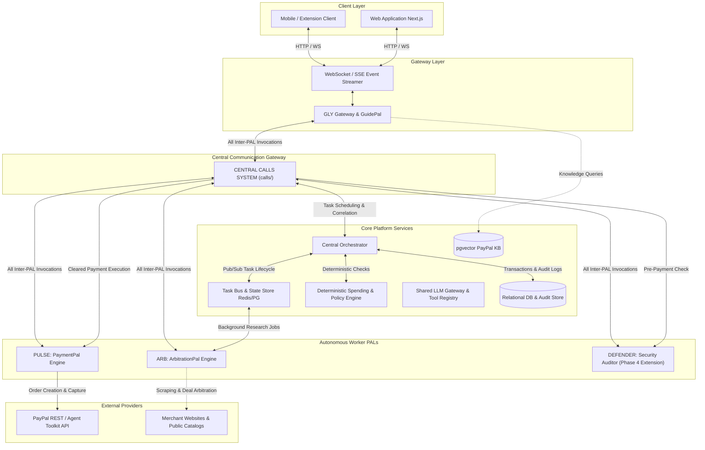
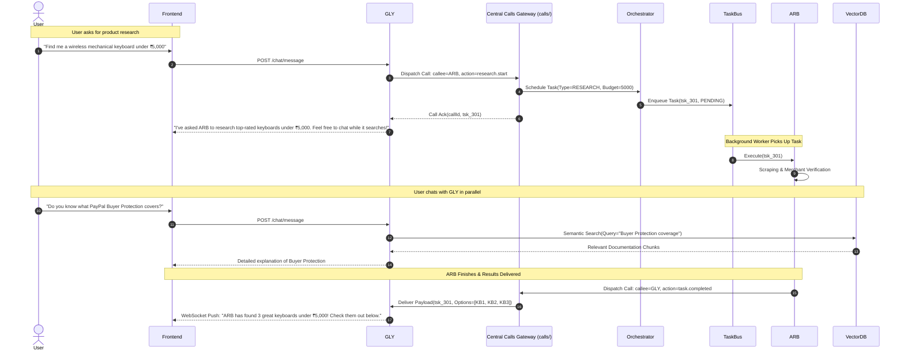
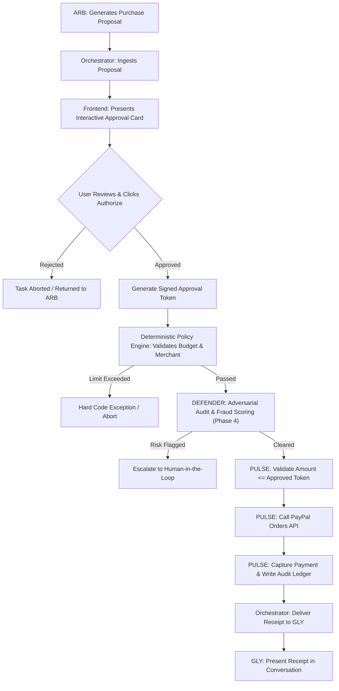
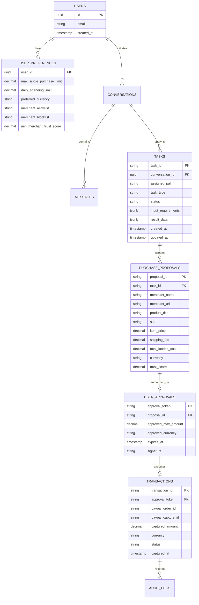
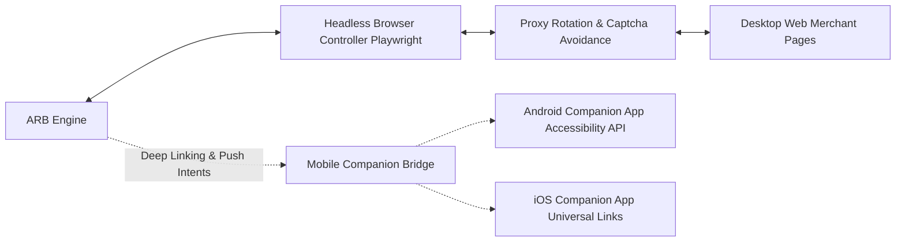

# PALS System Architecture Specification

> **Document Version:** 1.0.0  
> **Lifecycle Phase:** Phase 0 (Specification & Architecture)  
> **Target Audience:** System Architects, Multi-Agent Engineering Systems (Google Antigravity, Claude Code, OpenAI Codex)

---

## 1. System Topology Overview

PALS is designed as a **Modular Hub-and-Spoke Architecture** with an **Asynchronous Conversational Gateway**. 

The system separates conversational responsiveness from high-latency background operations (web scraping, merchant negotiation, multi-factor payment authorization).

---

## 2. The Conversational Gateway & Asynchronous Task Pattern

### 2.1 The GLY Gateway Pattern
To ensure the user experiences PALS as a unified, seamless assistant:
1. **Single Point of Ingestion:** Every message enters via GLY.
2. **Zero-Latency Non-Blocking Delegation:** When GLY recognizes a shopping or research intent, it formulates a structured task request, enqueues it with the Orchestrator, returns an immediate conversational acknowledgment, and releases the conversational lock.
3. **Out-of-Band Notification Streaming:** Background workers update task status in the central Task Store. As status transitions occur (`RESEARCHING`, `COMPLETED`, `AWAITING_INPUT`), events are dispatched through the Orchestrator to GLY, which streams friendly update cards into the active conversation thread.

---

## 3. Financial Safety & The Payment Execution Pipeline

### 3.1 Strict Payment Pipeline Topology
Financial transactions require verifiable human approval and multiple deterministic checks. Under no circumstance may any PAL bypass the validation chain:

$$\mathbf{ARB} \xrightarrow{\text{Purchase Proposal}} \mathbf{ORCHESTRATOR} \xrightarrow{\text{User Interactive Card}} \mathbf{USER} \xrightarrow{\text{Signed Approval}} \mathbf{POLICY\ ENGINE} \xrightarrow{\text{Pre-Payment Audit}} \mathbf{DEFENDER} \xrightarrow{\text{Cleared Order}} \mathbf{PULSE} \xrightarrow{\text{Capture}} \mathbf{PAYPAL}$$

### 3.2 Invalidation & Re-Approval Triggers
If any of the following parameters mutate between initial user approval and final checkout execution, the approval token is **automatically invalidated**:
1. **Landed Total Mutation:** Any increase in final price (taxes, shipping surcharges, currency drift) $> ₹0.00 / \$0.00$.
2. **Merchant Domain Divergence:** The final checkout redirect domain does not strictly match the approved merchant domain.
3. **Product Variant Shift:** SKU, color, model number, or condition changes.
4. **Token Expiration:** User approval tokens have a strict maximum TTL of 15 minutes.

---

## 4. Central Data Architecture & Entities

---

## 5. Cross-Cutting Shared Services (`shared/`)

To preserve the **Non-Duplication Policy**, shared capabilities reside in centralized modules:

1. **`shared/llm/`**: Uniform wrapper for Google Gemini, Anthropic Claude, and OpenAI models with standardized retries, token tracking, and structured schema parsing.
2. **`shared/policy/`**: Pure deterministic evaluation engine for user spending ceilings, daily totals, currency checks, and merchant verification.
3. **`shared/db/`**: Prisma / SQLAlchemy connection pools, migrations, and shared PostgreSQL entity models.
4. **`shared/tasks/`**: Abstract Task Manager interface implemented via Redis/BullMQ or in-memory buses for testing.
5. **`shared/logging/`**: Structured JSON logger (Winston / Loguru) with automated PII masking and distributed trace context propagation.

---

## 6. Device Interaction Architecture (Phase 3 Extension)

- **Desktop Browsing:** Sandboxed Playwright runners isolate web navigation from the host system.
- **Mobile Integration:** Employs approved OS-level deep linking and user-consented accessibility automation for merchant checkouts.
- **Safety Boundary:** The device automation runner cannot interact with banking or payment credentials directly.

