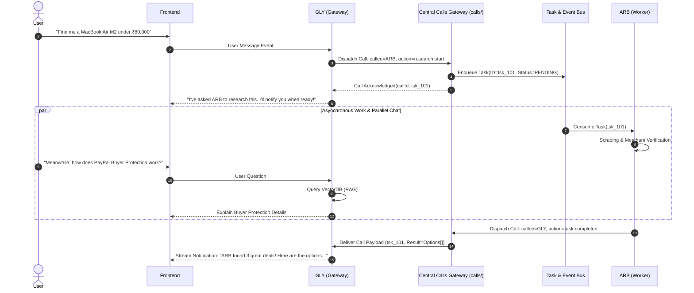

# PALS Technical Context & Architecture Context Document

> **Target Audience:** Autonomous AI Coding Agents (Google Antigravity, Claude Code, OpenAI Codex) & System Engineers  
> **Purpose:** Authoritative reference for project vision, component topologies, constraints, design invariants, and prohibited implementations.

---

## 1. Project Vision & Problem Statement

Modern e-commerce is overwhelmed by fragmented user experiences: opaque merchant pricing, confusing payment options, deceptive discount codes, hidden shipping fees, and complex dispute/refund rules. 

**PALS** (Personal AI Life & Shopping Companions) resolves this by deploying a **unified, multi-agent AI commerce ecosystem**. Rather than forcing users to juggle different tools for researching items, finding coupons, validating seller credibility, learning payment rules, and checking out, PALS provides a single companion experience with deep institutional knowledge and autonomous background capabilities.

### Core Philosophy
1. **Unified Persona to the User:** The user interacts exclusively with **GLY (GuidePal)**. To the user, PALS is a single trusted companion. Behind GLY sits an asynchronous orchestration fabric directing domain-specialized agents.
2. **Specialized Division of Labor:** Agents never cross operational domains. GLY handles guidance and dialogue; ARB handles research, comparison, and negotiation; PULSE executes payments; DEFENDER audits transactions for security anomalies.
3. **Deterministic Safety:** Agent decision-making is mediated by strict, code-enforced financial policies and human approvals. LLMs do not have permission to authorize transactions unilaterally.

---

## 2. In-Depth Companion Profiles

### 2.1 GLY — GuidePal (Conversational Gateway & PayPal Specialist)
- **Role:** Front-of-house conversational gateway and authoritative PayPal knowledge specialist.
- **Architectural Placement:** Sits directly between the user interface and the core platform orchestration engine.
- **Key Responsibilities:**
  - Ingests all conversational messages from the user interface.
  - Determines conversational intent: direct PayPal guidance vs. shopping research vs. transaction inquiry vs. order execution.
  - Answers complex PayPal questions via Retrieval-Augmented Generation (RAG) over official documentation (KYC, dispute resolution, buyer/seller protection, account limitations, fees, developer APIs).
  - Delegates shopping research to ARB asynchronously via the Orchestrator, acknowledging delegation to the user immediately.
  - Dispatches background notifications and completed research summaries into the conversation feed without disrupting other ongoing dialogue.
- **Operating Invariants & Guardrails:**
  - Non-blocking: GLY must never hang or wait synchronously for ARB to finish scraping or PULSE to finish an API call.
  - Must never independently execute web searches for product prices or invent shopping deals.
  - Must never make payment capture calls directly to PayPal; all such requests must be routed via the Orchestrator to PULSE.

### 2.2 ARB — ArbitrationPal (Research, Comparison & Negotiation Specialist)
- **Role:** Autonomous market intelligence, product arbitrage, merchant credibility analysis, and checkout preparation engine.
- **Architectural Placement:** Background worker invoked and managed strictly by the Orchestrator.
- **Key Responsibilities:**
  - Decomposes natural language queries (e.g., *"Find a 4K 144Hz monitor under ₹30,000 for gaming"*) into structured query parameters (category, price ceiling, required ports, panel type, warranty minimums).
  - Queries supported merchant sites, aggregates product listings, standardizes specifications, and calculates true landed costs (including shipping, taxes, and handling).
  - Evaluates merchant credibility using verifiable signals (seller age, verified review volume, return policy clarity, HTTPS certification) rather than just ranking the lowest sticker price.
  - Executes dynamic price negotiation where structured protocols or automated merchant dispute/discount mechanisms are supported.
  - Navigates merchant checkout flows up to the final payment authorization screen and packages the finalized purchase specification.
- **Operating Invariants & Guardrails:**
  - Prohibited from ever calling payment APIs, entering credit card numbers, or executing orders.
  - Prohibited from claiming a negotiated discount when only a publicly available voucher or coupon was applied.
  - Strictly bound by user-defined research policies (e.g., maximum budget, merchant blacklists).

### 2.3 PULSE — PaymentPal (Central Transaction & Payment Processor)
- **Role:** The solitary gateway for financial transactions, payment authorization, order capture, and PayPal API interactions.
- **Architectural Placement:** Protected backend service, sitting downstream of the Orchestrator and Pre-Payment Policy Checks (and future DEFENDER).
- **Key Responsibilities:**
  - Manages PayPal OAuth credential lifecycles, sandbox/production switching, and Agent Toolkit / MCP server connections.
  - Translates approved purchase requests into PayPal Orders (`v2/checkout/orders`).
  - Enforces deterministic spending policies (per-transaction caps, daily volume limits, currency matching) before creating or capturing orders.
  - Handles webhooks, payment captures, refund processing, dispute status verification, and invoice lookups.
  - Generates immutable audit logs and cryptographic receipt records for every financial event.
- **Operating Invariants & Guardrails:**
  - Must never accept payment requests directly from ARB or GLY; all payments must arrive via the Orchestrator with a verified user approval token.
  - Must never perform product research or converse with the user.
  - Must reject any order if the final payable amount exceeds the user's explicit authorization ceiling by even ₹0.01 / $0.01.

### 2.4 DEFENDER — Security & Credibility Assessment Layer (Phase 4 Provisional)
- **Role:** Pre-transaction adversarial auditor, scam detector, and prompt injection defense companion.
- **Architectural Placement:** In-line filter positioned immediately prior to PULSE in the checkout sequence:
  $$\text{ARB} \longrightarrow \text{ORCHESTRATOR} \longrightarrow \text{USER APPROVAL} \longrightarrow \mathbf{DEFENDER} \longrightarrow \text{PULSE} \longrightarrow \text{PAYPAL}$$
- **Key Responsibilities (Phase 4):**
  - Analyzes merchant URLs and checkout payloads for zero-day phishing indicators, fake reviews, or domain masquerading.
  - Scans user prompts and merchant DOM responses for prompt injection, indirect instruction smuggling, or price manipulation attacks.
  - Evaluates transaction risk scores and triggers automated step-up authentication or human-in-the-loop escalation.
- **Phase 0 Status:**
  - **Zero implementation in Phase 0/1.** The interface contract and dependency injection slots are architected so DEFENDER can be plugged in seamlessly during Phase 4 without refactoring PULSE or ARB.

---

## 3. Communication Architecture & The Central Calls System (`calls/`)

### 3.1 The Central Calls Gateway (`calls/`)
All communication between PALS must strictly route through the root-level `calls/` system.
- **Rule 1:** Every inter-agent communication must pass through `calls/`. No PAL is permitted to establish an independent communication mechanism with another PAL.
- **Rule 2:** GLY communicating with ARB (e.g. task handoffs) must use `calls/`.
- **Rule 3:** ARB communicating progress or results back to GLY must use `calls/`.
- **Rule 4:** PULSE and DEFENDER must also route requests, responses, and events through `calls/`.
- **Rule 5:** Each PAL only needs to know how to dispatch a call through this shared gateway, completely isolated from how another PAL internally operates.
- **Rule 6:** The calls system manages communication requests, responses, correlation tracking, timeouts, and task handoffs centrally.

### 3.2 The Conversational Gateway Pattern
Unlike peer-to-peer agent topologies where agents spam each other with unstructured dialogue, PALS operates as an **Orchestrated Star Topology mediated by `calls/` with GLY as the user-facing gateway**:

### 3.3 Key Coordination Rules
1. **Decoupled Task Lifecycle:** Research and checkout preparation tasks run asynchronously. The user never waits on a spinning loader while an agent browses web pages.
2. **Central Gateway Routing:** All handoffs, progress events, and results pass through `calls/`.
3. **No Direct Inter-PAL Coupling:** ARB does not know how PULSE processes payments; PULSE does not know how ARB finds prices. All handoffs occur via strict JSON schemas administered through `calls/`.

---

## 4. Deterministic Spending & Policy Engine

A critical failure mode of LLM-based shopping assistants is prompt manipulation or model hallucinations leading to unauthorized spending. In PALS, financial safety is **deterministic**:

- **Hard Price Caps:** If a user specifies a budget of ₹75,000, the Orchestrator and PULSE hard-fail any order creation where `order.amount.total > 75000.00`.
- **Re-Approval Invariants:** If an item is approved at ₹74,500, but the merchant adds ₹600 for shipping at checkout, bringing the total to ₹75,100, the transaction is automatically aborted, and a re-approval challenge is triggered.
- **Merchant Allowlists/Blocklists:** Disallowed merchant domains are rejected in code before browser automation or checkout generation begins.
- **Atomic User Approval Tokens:** Every purchase request requires a signed, time-limited approval token generated by the user in the frontend UI. PULSE validates this cryptographic token prior to communicating with PayPal.

---

## 5. Explicitly Excluded Features

To maintain strict architectural focus, the following capabilities are **explicitly out of scope**:
1. **Unsolicited Autonomous Purchases:** PALS will never execute a payment without explicit, human-confirmed checkout authorization.
2. **Cryptocurrency & Unregulated Payment Rails:** PULSE interacts strictly with official PayPal payment infrastructure; no crypto wallets, Web3 smart contracts, or unauthorized escrow services.
3. **Direct Agent-to-User Bypasses:** ARB, PULSE, and DEFENDER will never render arbitrary UI or send direct messages to the user without passing through GLY and the Orchestration layer.
4. **Credential Harvesting:** Under no circumstances will PALS scrape or store plain-text credit card details or PayPal account passwords. All authentication is handled through official PayPal OAuth2 flows.

