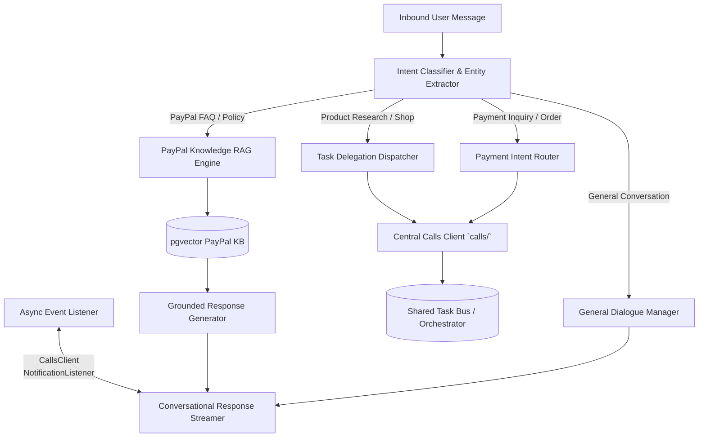

# GLY Technical Context & Operating Architecture

> **Module:** GLY (GuidePal)  
> **Lifecycle Phase:** Phase 0 (Specification Baseline)  
> **Target Audience:** AI Coding Agents assigned to GLY

---

## 1. Internal Architecture

GLY operates four primary internal functional subsystems:

---

## 2. Intent Classification Taxonomy

GLY classifies every inbound user message into one of four deterministic intent routes:

1. **`INTENT_PAYPAL_GUIDANCE`**:
   - *Examples:* "How do I file a dispute?", "Why is my payment pending?", "What are PayPal's cross-border conversion fees?", "How do I set up webhooks?".
   - *Action:* Trigger RAG Pipeline against `pgvector` knowledge base. Return grounded answer with citations.
2. **`INTENT_SHOPPING_RESEARCH`**:
   - *Examples:* "Find me a 4K gaming monitor under ₹30,000", "Where can I buy an ergonomic office chair for cheap?".
   - *Action:* Extract structured entities (category, price ceiling, specifications) and dispatch an asynchronous `RESEARCH` task to ARB via the Orchestrator. Send immediate conversational acknowledgment to user.
3. **`INTENT_PURCHASE_CONFIRMATION`**:
   - *Examples:* "I want to buy option 1", "Proceed with checkout on the ₹68,500 laptop".
   - *Action:* Validate active purchase proposal. Prompt user with the interactive approval card for digital signature. Route approved token to Orchestrator.
4. **`INTENT_PAYMENT_INQUIRY`**:
   - *Examples:* "Where did my ₹4,500 payment go?", "Check the status of my refund for Order #991".
   - *Action:* Request authorized transaction lookup via Orchestrator $\rightarrow$ PULSE, format receipt details, and explain payment status.

---

## 3. RAG Pipeline Design (PayPal Knowledge Base)

- **Knowledge Domain:**
  - Consumer topics: Registration, KYC/verification, sending/receiving, holds, dispute resolution, refunds, subscriptions, Buyer & Seller Protection.
  - Merchant/Developer topics: PayPal REST v2 APIs, Orders API, Webhook verification, sandbox onboarding, fee structures.
- **Chunking & Indexing Strategy:**
  - Semantic section-aware chunking (max 512 tokens with 64-token overlap).
  - Metadata indexing by category (`FEES`, `DISPUTES`, `DEVELOPER`, `PROTECTION`).
- **Grounded Verification Invariant:**
  - GLY must include source references in responses. If RAG confidence score $< 0.70$, GLY must state that official documentation does not contain an authoritative answer and suggest contacting official PayPal customer service.

---

## 4. Asynchronous Task Management & Non-Blocking Rules

When delegating a task to ARB:
1. **Never Block:** GLY must immediately return a conversational acknowledgment within 500ms.
2. **State Decoupling:** The user's active session remains open. If the user immediately asks *"Also, how do I link a bank account to PayPal?"*, GLY answers instantly while ARB continues scraping in the background.
3. **Out-of-Band Notification:** When the task transitions to `COMPLETED`, GLY receives a callback via the task event listener and streams a formatted result card into the chat thread.

