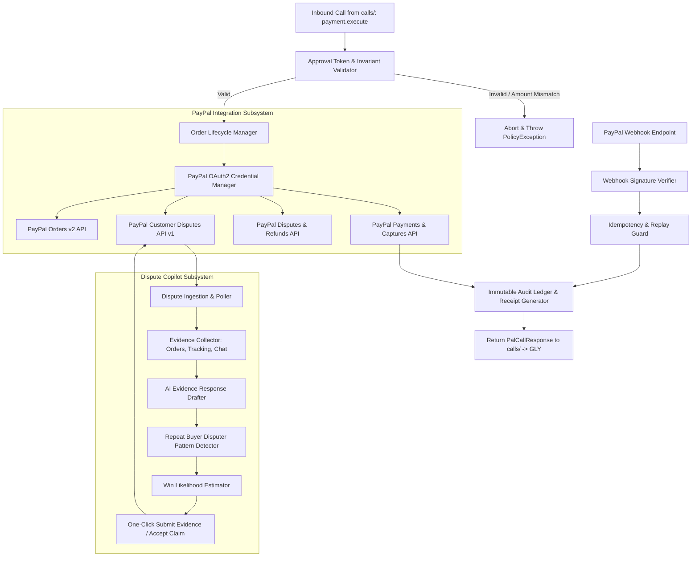
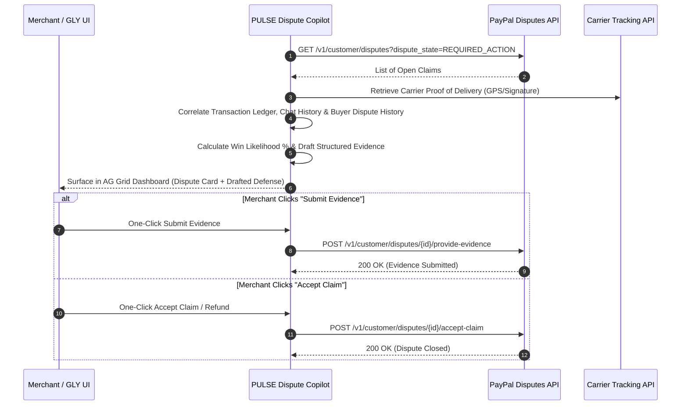

# PULSE Technical Context & Operating Architecture

> **Module:** PULSE (PaymentPal)  
> **Lifecycle Phase:** Phase 0 (Specification Baseline)  
> **Target Audience:** AI Coding Agents assigned to PULSE

---

## 1. Internal Architecture

---

## 2. Order Lifecycle State Machine

PULSE strictly isolates the distinct stages of payment processing:

1. **Stage 1: ORDER_CREATED**
   - PULSE calls PayPal `POST /v2/checkout/orders` with `intent: "CAPTURE"`.
   - Returns a `paypalOrderId` and checkout approval redirect URL.
2. **Stage 2: BUYER_APPROVED**
   - The buyer authenticates with PayPal and approves the transaction.
   - PayPal emits an approval return webhook / callback.
3. **Stage 3: AMOUNT_VERIFIED (Deterministic Gate)**
   - Prior to capture, PULSE fetches order details from PayPal:
     $$\text{capturedAmount} \le \text{token.authorizedMaxAmount}$$
   - If `capturedAmount > token.authorizedMaxAmount`, capture is **aborted**.
4. **Stage 4: PAYMENT_CAPTURED**
   - PULSE executes `POST /v2/checkout/orders/{id}/capture`.
   - On `201 Created` with status `COMPLETED`, the transaction is settled.
5. **Stage 5: LEDGER_WRITTEN**
   - Transaction ID, capture ID, timestamps, fees, and currency are committed to the immutable database ledger.
   - Digital receipt payload returned to Orchestrator.

---

## 3. Webhook Handling & Idempotency Rules

- **Signature Verification:** Every webhook must be validated against PayPal's public keys via PayPal's `/v1/notifications/verify-webhook-signature` endpoint. Unsigned or invalid webhooks are rejected with `400 Bad Request`.
- **Idempotency Keys:** Every payment capture request generates a unique idempotency key:
  $$\text{PayPal-Request-Id} = \text{SHA256}(\text{approvalToken} + \text{proposalId})$$
  This guarantees that duplicate network retries can never double-charge a user.

---

## 4. Dispute Copilot Architecture & Workflow

Small merchants frequently lose disputes and chargebacks because they lack the legalistic knowledge or time to format evidence within PayPal's strict response windows. Dispute Copilot automates defense preparation:

### Core Subsystems:
1. **Dispute Ingestion:** Interrogates `GET /v1/customer/disputes` to detect newly opened claims (INR: Item Not Received, SNAD: Significantly Not As Described, Unauthorized).
2. **Automated Evidence Compilation:** Aggregates order timestamps, shipping tracking numbers with carrier delivery confirmations, buyer IP logs, and customer service chats.
3. **Repeat Pattern & Anomaly Detection:** Queries the transaction ledger to flag repeat disputers (e.g., *"Warning: This buyer account has initiated 3 disputes across merchants in the past 60 days"*).
4. **Structured Evidence Drafting:** Synthesizes PayPal Seller Protection-compliant responses citing specific policy clauses.
5. **Sandbox Testing Strategy & Risk Mitigation:** Generating live disputes in PayPal's sandbox can be complex. PULSE introduces a dedicated Sandbox Dispute Seeder (`PULSE/disputes/sandbox_seeder.ts`) and mock dispute fixtures to ensure complete testability before live deployment.

---

## 5. Integration with PayPal Agent Toolkit & MCP

In Phase 1+, PULSE wraps official PayPal integration tools:
- Standard REST API v2 SDK.
- PayPal Agent Toolkit / Model Context Protocol (MCP) server endpoints for automated transaction status lookups, invoice management, and dispute checking.
- Sandboxed credentials configured strictly via `.env` (`PAYPAL_MODE=sandbox`).

