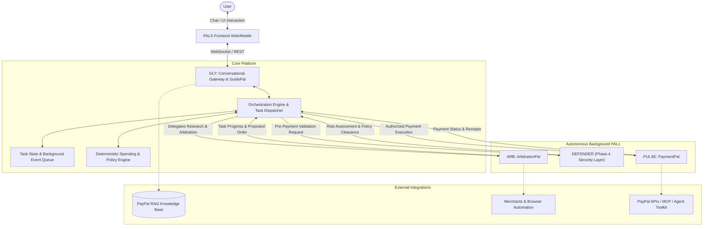

# PALS — Personal AI Life & Shopping Companions

> **Unified Multi-Agent AI Commerce Assistance Platform**  
> *Architected for multi-agent autonomous engineering (Google Antigravity, Claude Code, OpenAI Codex)*

---

## 1. Executive Summary

**PALS** (Personal AI Life & Shopping Companions) is a multi-agent AI commerce assistance platform designed to help users understand payment ecosystems (specifically PayPal), conduct comprehensive market and product research, compare merchants, negotiate deals, and execute secure, authorized purchases.

Unlike conventional chatbots or fragmented shopping assistants, PALS is a single, cohesive ecosystem of four specialized AI companions operating over a shared orchestration, memory, policy enforcement, and communication fabric:

1. **GLY (GuidePal)**: The conversational gateway and PayPal knowledge/RAG specialist.
2. **ARB (ArbitrationPal)**: The product research, comparison, merchant validation, and purchase preparation specialist.
3. **PULSE (PaymentPal)**: The central, hardened PayPal payment processing and transaction lifecycle engine.
4. **DEFENDER (Provisional Name)**: The planned transaction security, merchant credibility, and prompt injection defense layer (Phase 4).

All user interactions enter through a single point of contact—**GLY**. GLY acts as a non-blocking conversational front-of-house that delegates long-running workflows (such as merchant scraping or price arbitration) to ARB and payment tasks to PULSE via a centralized Orchestration Engine, maintaining uninterrupted conversational availability with the user.

---

## 2. Core Architectural Philosophy

### A. Non-Duplication Policy ("One Capability = One Central Implementation")
No PAL or agent may independently build its own utility layers. Cross-cutting concerns—such as LLM clients, vector databases, task queues, session storage, device automation, and payment gateways—reside strictly in `shared/` or designated PAL modules.

### B. Central Calls Gateway (`calls/`)
All inter-agent communication flows through the dedicated, root-level `calls/` system. No PAL may directly communicate with or invoke another PAL's internal APIs. Every task delegation, status query, and payment handoff is dispatched through the centralized, reusable calls infrastructure.

### C. Single Conversational Gateway
Users never communicate directly with backend workers (ARB, PULSE, DEFENDER). Every conversation flows through GLY. GLY interprets user intent, coordinates tasks asynchronously via `calls/`, streams notifications back into the chat thread, and maintains conversational continuity.

### D. Deterministic Spending & Policy Enforcement
User financial constraints (maximum budgets, daily limits, merchant allowlists, approval policies) are **never left to LLM prompt adherence alone**. They are validated by strict, deterministic application code within the Orchestration and Payment layers before any external transaction call is permitted.

### D. Multi-Agent Teamwork Standards
PALS is developed concurrently by multiple AI agents (Google Antigravity, Claude Code, OpenAI Codex). Module ownership boundaries are strict: agents must not alter modules outside their assigned scope without updating centralized contracts in [API_CONTRACTS.md](API_CONTRACTS.md).

---

## 3. The Four Companions

| PAL | Identity / Role | Primary Responsibilities | Prohibited Actions |
| :--- | :--- | :--- | :--- |
| **GLY** | **GuidePal**<br>*(Conversational Gateway & PayPal Knowledge)* | • Primary conversational entry point for all users.<br>• Non-blocking dialogue management and task delegation.<br>• Authoritative PayPal RAG & documentation guidance.<br>• Delivering task status updates and finalized results. | • General-purpose open web scraping.<br>• Direct product price negotiation.<br>• Independent payment capture/refund.<br>• Bypassing orchestrator to invoke PULSE directly. |
| **ARB** | **ArbitrationPal**<br>*(Research, Comparison & Negotiation)* | • Natural-language requirement extraction.<br>• Multi-merchant product search and spec comparison.<br>• Merchant credibility and trust scoring.<br>• Merchant negotiation (via supported APIs/chat protocols).<br>• Purchase intent preparation & checkout automation. | • Direct payment execution or card capture.<br>• Storing raw payment credentials.<br>• Independent PayPal OAuth handling.<br>• Fabricating unverified discounts or coupon codes. |
| **PULSE** | **PaymentPal**<br>*(Central Payment Processing)* | • Centralized PayPal OAuth & Agent Toolkit integration.<br>• PayPal Orders, Authorizations, Captures, and Refunds.<br>• Webhook verification and transaction reconciliation.<br>• Deterministic budget and currency limit checks.<br>• Transaction ledger and digital receipts. | • Product research or catalog browsing.<br>• Arbitrating or comparing prices.<br>• Direct conversational interfacing with the user.<br>• Bypassing user approval requirements. |
| **DEFENDER** | **Security Companion**<br>*(Phase 4 Provisional Architecture)* | • Sits immediately before PULSE in the checkout chain.<br>• Merchant risk scoring and scam domain detection.<br>• Prompt injection and hidden instruction mitigation.<br>• Transaction anomaly detection and human escalation. | • Phase 1–3 execution (Architectural placeholder only).<br>• Modifying payment amounts or payloads directly. |

---

## 4. High-Level System Architecture



---

## 5. Repository Structure

```text
PALS/
├── GLY/                        # GuidePal: Conversational gateway & PayPal RAG engine
│   ├── README.md               # GLY system overview
│   ├── CONTEXT.md              # Technical context, LLM prompts & RAG design
│   ├── MEMORY.md               # GLY development status & decision record
│   └── RESPONSIBILITIES.md     # GLY boundary specifications & tool whitelist
│
├── ARB/                        # ArbitrationPal: Product research & negotiation
│   ├── README.md               # ARB system overview
│   ├── CONTEXT.md              # Scraper architecture, negotiation logic & state machines
│   ├── MEMORY.md               # ARB development status & decision record
│   └── RESPONSIBILITIES.md     # ARB boundary specifications & constraints
│
├── PULSE/                      # PaymentPal: Central PayPal payment engine
│   ├── README.md               # PULSE system overview
│   ├── CONTEXT.md              # PayPal APIs, MCP tools, webhooks & transaction logs
│   ├── MEMORY.md               # PULSE development status & decision record
│   └── RESPONSIBILITIES.md     # PULSE boundary specifications & safety rules
│
├── defender/                   # DEFENDER: Future security & credibility layer (Phase 4)
│   ├── README.md               # Architectural specification & extension points
│   ├── CONTEXT.md              # Security model, threat catalog & evaluation criteria
│   ├── MEMORY.md               # Security backlog & deferred implementation log
│   └── RESPONSIBILITIES.md     # Security boundary definitions
│
├── calls/                      # Central Calls System: Single communication gateway between all PALS
│   ├── README.md               # System overview, routing rules & envelope definitions
│   ├── CONTEXT.md              # Technical design, dispatch protocol & lifecycle
│   └── RESPONSIBILITIES.md     # Interface boundaries, routing invariants & error handling
│
├── frontend/                   # Web and mobile conversational UI
├── shared/                     # Cross-cutting libraries (types, db, llm, policy, task queue)
├── docs/                       # Architecture diagrams, specifications, guides
├── tests/                      # System integration and end-to-end test suites
│
├── README.md                   # This document
├── CONTEXT.md                  # Comprehensive AI context for coding agents
├── MEMORY.md                   # Persistent project memory & change log
├── PRD.md                      # Product Requirements Document & technology evaluations
├── ARCHITECTURE.md             # In-depth architectural designs & Mermaid flows
├── API_CONTRACTS.md            # Inter-agent and internal RPC/data contracts
├── DEVELOPMENT_RULES.md        # Strict engineering standards & multi-agent rules
├── ROADMAP.md                  # Phase 0 through Phase 4 milestones
├── .gitignore                  # Git ignore rules
└── .env.example                # Environment variable configuration template
```

---

## 6. Development Status & Roadmap Overview

The project follows a phased delivery schedule:

- **Phase 0 (Current Phase)**: **Architecture & Documentation System**. Folder structures, interface contracts, module boundaries, deterministic policy definitions, and memory records established. **Zero application code.**
- **Phase 1**: **Core Foundation**. Shared infrastructure, orchestration engine, GLY gateway & PayPal RAG, fundamental ARB scraping, PULSE PayPal sandbox.
- **Phase 2**: **Advanced ARB & Deal Arbitration**. Multi-merchant spec matrix, merchant credibility ratings, negotiation protocols, checkout preparation.
- **Phase 3**: **Cross-Device Interaction**. Desktop browser automation and mobile companion applications.
- **Phase 4**: **DEFENDER Security Layer**. Live transaction risk evaluation, scam domain blacklisting, prompt injection guards.

---

## 7. Essential Documentation Index

Before modifying or adding code in Phase 1+, all coding agents and contributors must read:

1. [CONTEXT.md](CONTEXT.md) — Comprehensive technical mission, constraints, and operating philosophies.
2. [DEVELOPMENT_RULES.md](DEVELOPMENT_RULES.md) — Multi-agent collaboration protocols, code standards, and non-duplication rules.
3. [API_CONTRACTS.md](API_CONTRACTS.md) — Strict JSON schema contracts between GLY, Orchestrator, ARB, and PULSE.
4. [ARCHITECTURE.md](ARCHITECTURE.md) — Detailed message flows, background task state machine, and data architecture.
5. [PRD.md](PRD.md) — Requirements, user stories, acceptance criteria, and technology stack rationales.
6. [MEMORY.md](MEMORY.md) — Live changelog and architectural decision registry.
