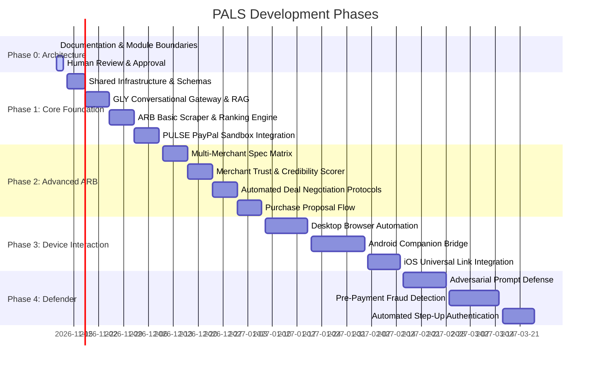

# PALS Master Development Roadmap

> **Lifecycle Phase:** Phase 0 Active  
> **Target Release:** Multi-Agent Progressive Delivery (Phases 0 through 4)

---

## Roadmap Overview

---

## Detailed Phase Breakdown

### Phase 0: Architecture & Documentation (CURRENT)
- [x] Complete workspace audit and repository topology definition.
- [x] Establish four PAL modules (`GLY`, `ARB`, `PULSE`, `defender`) with individual documentation quartets.
- [x] Establish platform modules (`frontend/`, `shared/`, `docs/`, `tests/`).
- [x] Author comprehensive root documentation: `README.md`, `CONTEXT.md`, `MEMORY.md`, `PRD.md`, `ARCHITECTURE.md`, `API_CONTRACTS.md`, `DEVELOPMENT_RULES.md`, `ROADMAP.md`.
- [x] Define asynchronous task management and conversational gateway pattern.
- [x] Define deterministic spending policy enforcement model.
- [x] Establish Defender extension points immediately preceding PULSE.
- [ ] **Milestone 0 Exit Gate:** Complete human architect review and authorization to proceed to code.

---

### Phase 1: Core Foundation
*Objective: Build the minimal viable end-to-end loop with mock/sandbox services.*

#### 1.1 Shared Infrastructure
- Setup monorepo package configuration (`pnpm` workspaces / Python virtual environment).
- Implement `shared/types/` from [API_CONTRACTS.md](API_CONTRACTS.md) with Zod runtime validators.
- Implement `shared/llm/` provider abstraction supporting Gemini and Claude.
- Implement `shared/policy/` deterministic budget and merchant validator.
- Implement `shared/tasks/` in-memory / Redis task bus with state transition guards.

#### 1.2 GLY (GuidePal) Foundation
- Build conversational gateway handler supporting streaming responses.
- Implement intent classification engine (PayPal FAQ vs. Shopping vs. Payment).
- Setup `pgvector` pipeline ingesting PayPal developer and consumer documentation.
- Implement task delegation dispatcher and asynchronous result listener.

#### 1.3 ARB (ArbitrationPal) MVP
- Build structured query entity extractor (category, max price, brand, specs).
- Implement initial mock/Playwright scraper for target merchant listings.
- Implement basic ranking algorithm prioritizing budget compliance and availability.

#### 1.4 PULSE (PaymentPal) Sandbox
- Implement PayPal OAuth2 client credential manager with auto-refresh.
- Implement `v2/checkout/orders` creation and capture routines in sandbox mode.
- Implement webhook receiver with signature verification.
- Enforce deterministic check: `order.total <= approvalToken.maxAmount`.

#### 1.5 Frontend Foundation
- Next.js chat interface connected to GLY via WebSockets.
- Real-time rendering of task status pills (e.g., "ARB is researching...").
- Interactive Purchase Proposal approval card.

---

### Phase 2: Advanced ARB & Deal Arbitration
*Objective: Comprehensive market intelligence, deep product comparison, and coupon negotiation.*

- Multi-merchant normalized specification matrix (comparing laptops, electronics, etc.).
- Merchant credibility and trust scoring algorithm (domain age, reviews, HTTPS, return policies).
- Automated negotiation engine: interaction with supported merchant coupon / promotional endpoints.
- Accurate landed cost calculator including taxes, postal delivery rates, and handling surcharges.
- Dynamic Purchase Proposal generator with 15-minute expiration timers.

---

### Phase 3: Cross-Device Interaction
*Objective: Seamless continuity across desktop browsers and mobile devices.*

- Desktop browser automation agent via Playwright with headful review modes.
- Android companion application bridge utilizing authorized Accessibility Services for guided checkout.
- iOS Universal Link and Safari Extension integration.
- Cross-device session continuity: Start research on desktop, authorize payment on mobile phone.

---

### Phase 4: Defender Security Layer
*Objective: Advanced adversarial defenses and pre-payment anomaly detection.*

- In-line security filter positioned between User Approval and PULSE.
- Real-time merchant domain scam verification and SSL inspection.
- Indirect prompt injection detection on merchant review pages and scraped DOM nodes.
- Transaction velocity and behavioral risk scoring.
- Automated step-up authentication and human escalation workflows for suspicious purchases.

