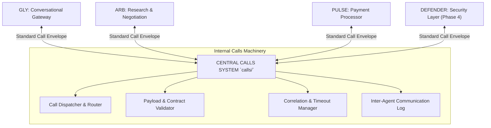

# Calls System Technical Context & Protocol Design

> **Module:** `calls/` (Central Inter-Agent Gateway)  
> **Lifecycle Phase:** Phase 0 (Specification Baseline)  
> **Audience:** System Architects & Multi-Agent Engineering Systems

---

## 1. Architectural Role & Topology

In a multi-agent system, peer-to-peer coupling leads to exponential complexity:
$$N \times (N - 1) \text{ communication channels}$$

With four agents, unmediated communication results in 12 distinct coupling points. The `calls/` system collapses this into a single, centralized Star Bus:



Every PAL connects only to `calls/`.

---

## 2. Standard Call Envelope Structure

All communications routed through `calls/` are wrapped in a standard JSON envelope:

```typescript
export type PALIdentifier = 'GLY' | 'ARB' | 'PULSE' | 'DEFENDER';

export interface PalCallEnvelope<T = unknown> {
  callId: string;             // Unique invocation ID (e.g. call_01HXYZ)
  correlationId: string;      // Traces conversational thread or root task ID
  caller: PALIdentifier;      // Originating PAL
  callee: PALIdentifier;      // Target PAL
  action: string;             // Method/Action name (e.g., 'research.start', 'payment.authorize')
  payload: T;                 // Action-specific data payload conforming to API_CONTRACTS.md
  metadata: {
    timestamp: string;        // ISO 8601
    timeoutMs: number;        // Max execution time before timeout
    idempotencyKey?: string;  // Prevents duplicate operations
  };
}

export interface PalCallResponse<R = unknown> {
  callId: string;
  correlationId: string;
  responder: PALIdentifier;
  status: 'SUCCESS' | 'ERROR' | 'TIMEOUT' | 'QUEUED';
  data?: R;
  error?: {
    code: string;
    message: string;
    details?: unknown;
  };
  durationMs: number;
  completedAt: string;
}
```

---

## 3. Communication Patterns Supported

1. **Synchronous Request-Response (Fast Calls):**
   - Direct queries that complete in $< 500\text{ms}$ (e.g., GLY querying PULSE for verified balance or transaction status).
2. **Asynchronous Task Delegation (Handoff Calls):**
   - Long-running jobs (e.g., GLY delegating merchant research to ARB). The call returns immediately with `status: 'QUEUED'` and a `taskId`.
3. **Event Notification Callbacks (Push Calls):**
   - When a worker finishes a job or requires user input, it dispatches an event call through `calls/` back to the requesting PAL (e.g., ARB $\rightarrow$ `calls/` $\rightarrow$ GLY).

---

## 4. Invariants & Guardrails

- **Zero Direct Importation:** Code in `GLY/` must never import modules from `ARB/`, and `PULSE/` must never import code from `defender/`.
- **Contract Enforcement:** The `calls/` router validates all payloads against schemas defined in [API_CONTRACTS.md](../API_CONTRACTS.md) before dispatching to the callee.
- **Traceability:** Every call is logged with its `callId` and `correlationId` for unified system debugging.

