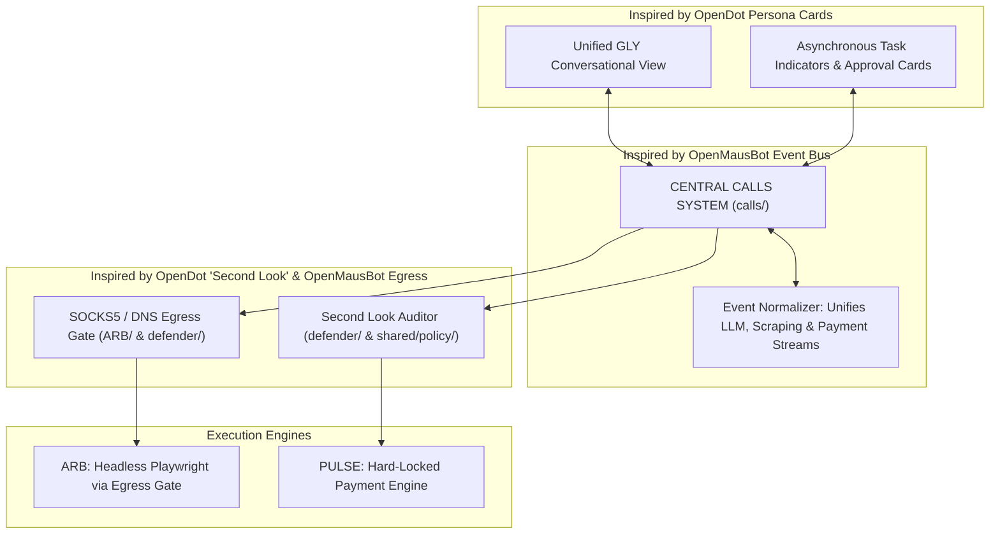

# Architectural Analysis & Integration Plan: OpenMausBot & OpenDot

> **Document Version:** 1.0.0  
> **Lifecycle Phase:** Phase 0 / Research & Evaluation  
> **Target Audience:** PALS System Architects & Multi-Agent Engineering Systems  
> **Reference Repositories:**
> - [OpenMausBot (`milind-soni/OpenMausBot`)](https://github.com/milind-soni/OpenMausBot)
> - [OpenDot (`thinkwee/OpenDot`)](https://github.com/thinkwee/OpenDot)

---

## 1. Executive Summary & Strategic Recommendation

Both **OpenMausBot** and **OpenDot** provide mature, production-grade patterns for autonomous, local-first agent systems. Rather than adopting either repository wholesale as an external dependency, PALS should selectively adapt their architectural patterns into our existing modular architecture (`shared/`, `calls/`, `ARB/`, `PULSE/`, `defender/`).

### Architectural Fit Matrix

| Capability / Pattern | Source Repository | Applicable PALS Module | Adoption Recommendation |
| :--- | :--- | :--- | :--- |
| **SOCKS5 Browser Egress & DNS Filtering** | `OpenMausBot` (`server/browser/egress/`) | `ARB/` & `defender/` | **HIGH PRIORITY (Phase 2/3)**: Essential for securing ARB's headless browser scraping and preventing SSRF / DNS rebinding attacks. |
| **Unified Agent Event Normalization Stream** | `OpenMausBot` (Harness Event Bus) | `calls/` & `shared/tasks/` | **HIGH PRIORITY (Phase 1)**: Ingests heterogeneous worker events (LLM tokens, Playwright steps, payment callbacks) into standard call envelopes. |
| **"Second Look" Action Verification** | `OpenDot` (HITL Guard Layer) | `shared/policy/` & `defender/` | **HIGH PRIORITY (Phase 1 & 4)**: Audits an agent's proposed action against the user's initial natural-language prompt and structured budget limits. |
| **Hard Financial Lockouts** | `OpenDot` (Safety Boundary System) | `PULSE/` & `shared/policy/` | **APPROVED INVARIANT**: Reinforces our rule that financial execution is permanently gated by deterministic code and cryptographic user sign-off. |
| **Configurable Trust Profiles** | `OpenDot` (Permissions Engine) | `frontend/` & `shared/policy/` | **MEDIUM PRIORITY (Phase 2)**: Allows users to configure pre-approved thresholds (e.g., auto-research under ₹5,000, but mandate manual approval for higher tiers). |
| **Local Loopback Security (`127.0.0.1`)** | `OpenMausBot` (`server/`) | `shared/orchestrator/` | **APPROVED INVARIANT**: Isolates backend harness and PayPal client credentials from client-side scripts. |
| **Email Alias Isolation (`you+agent@gmail.com`)** | `OpenDot` (Email Manager) | Out of Scope | **REJECTED**: Unneeded complexity; PALS communicates via WebSockets/REST, not email relays. |

---

## 2. In-Depth Analysis: OpenMausBot (`milind-soni/OpenMausBot`)

### 2.1 Repository Architecture Overview
OpenMausBot is an open-source, local-first desktop workspace and agent execution harness. It pairs an Electron/React front-end with an isolated local Node.js harness server. Its standout innovations center on **sandboxed agent execution, browser automation containment, and event streaming**.

### 2.2 Reusable Structures & Methods for PALS

#### A. Browser Egress Gateway & SOCKS5 Isolation (`server/browser/egress/`)
- **The Problem in PALS:** In Phase 2+, ARB will use headless Playwright instances to crawl e-commerce platforms. Rogue merchant websites or malicious ad redirects could attempt DNS rebinding, internal subnet port scanning, or arbitrary file downloads.
- **OpenMausBot Solution:** OpenMausBot routes all headless browser network traffic through a local SOCKS5 proxy layer that intercepts every outbound request, validates the target domain against allowlists, and enforces strict DNS resolution checks.
- **How PALS Should Use This:**
  - Introduce an egress proxy interceptor in `ARB/scrapers/egress.ts`.
  - Validate merchant URLs against `shared/policy/` allowlists before the browser dispatches HTTP requests.
  - Reject local loopback (`127.0.0.1`, `192.168.*`) egress from headless browsers to guarantee sandboxing.

#### B. Unified Agent Event Normalization Stream
- **The Problem in PALS:** ARB emits scraping progress, GLY emits streaming LLM tokens, and PULSE emits webhook status updates. Managing divergent event streams creates spaghetti code.
- **OpenMausBot Solution:** Ingests raw events from different tools/runtimes and transforms them into a normalized typed stream (`AgentEvent` with standardized payloads: `step_start`, `log`, `approval_needed`, `artifact`, `completed`).
- **How PALS Should Use This:**
  - Mirror this pattern in `calls/dispatcher/normalizer.ts` to transform worker output into `PalCallResponse` envelopes.

#### C. Local Provider Key Isolation
- **The Problem in PALS:** PayPal Client Secrets and LLM API keys must never leak to browser clients or logs.
- **OpenMausBot Solution:** Strict separation where the client UI never touches raw API keys; all outbound provider calls are executed on the local backend harness.
- **How PALS Should Use This:**
  - Maintain the rule that PayPal secrets exist solely in `PULSE/`, invoked via authenticated local endpoints.

---

## 3. In-Depth Analysis: OpenDot (`thinkwee/OpenDot`)

### 3.1 Repository Architecture Overview
OpenDot is a self-hosted personal agent framework built around the concept of a "team of personal assistants" running locally. Its primary strengths lie in **Human-in-the-Loop (HITL) safety design, persona isolation, and trust management**.

### 3.2 Reusable Structures & Methods for PALS

#### A. The "Second Look" Verification Paradigm
- **The Problem in PALS:** An autonomous shopping agent (ARB) might misunderstand complex product variants (e.g., mistaking a refurbished 8GB laptop for a new 16GB laptop) or accept merchant terms with hidden subscription renewals.
- **OpenDot Solution:** OpenDot implements an automated "Second Look" pass: before high-stakes actions proceed to human review, an independent evaluation pass audits the proposed action against the user's initial constraints.
- **How PALS Should Use This:**
  - Integrate this directly into `defender/` (and the Phase 1 Orchestrator):
    $$\text{User Request} + \text{Purchase Proposal} \xrightarrow{\text{Second Look}} \text{Discrepancy Check}$$
  - Verifies: Did the price stay within budget? Does the warranty match? Are there recurring subscription clauses?

#### B. Permanently Locked Actions (Hard Financial Gates)
- **OpenDot Safety Invariant:** OpenDot identifies critical operations that can **NEVER** be delegated to autonomous execution—specifically financial payments, password changes, and account deletions.
- **How PALS Uses This:**
  - Confirms our core architectural invariant: PULSE cannot capture payments without an active, cryptographically signed `UserApprovalToken`. Autonomous agents cannot bypass this check under any circumstance.

#### C. Configurable Trust Profiles (Graduated Autonomy)
- **OpenDot Solution:** Users can configure permissions along trust gradients:
  - *Tier 1 (Autonomous):* Read-only actions (searching catalogs, comparing specs, reading PayPal docs).
  - *Tier 2 (Supervised):* Checkout cart preparation, address selection.
  - *Tier 3 (Locked):* Fund transfers and payment captures (mandatory interactive confirmation).
- **How PALS Should Use This:**
  - Model this in `shared/policy/` as part of `UserFinancialPolicy` to give users granular control over ARB's automation scope.

---

## 4. Synthesis: How PALS Architecture Incorporates Both Systems

---

## 5. Immediate Action Plan

1. **Document Evaluation in Memory:** Add ADR-007 to `MEMORY.md` recording the adoption of OpenMausBot's Egress Gateway and OpenDot's "Second Look" verification paradigm.
2. **Update PRD:** Incorporate graduated trust tiers and browser network sandboxing into Non-Functional Requirements.
3. **No Code Implementation Right Now:** Per project rules, keep these findings documented in `docs/research/` as approved architectural patterns to be implemented during Phases 1–4.

